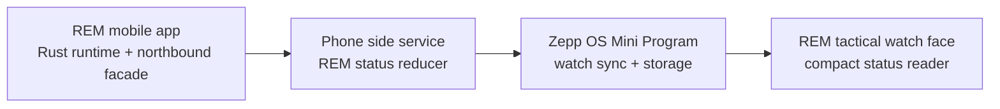

# REM Sync Mini Program And Side Service

Use this guide for the parallel Zepp OS companion layer that feeds REM tactical status to an Amazfit T-Rex 2 watch face.

This is not the watch face implementation. The watch face should only consume compact values prepared by the companion layer. The companion layer should read REM through a northbound API or phone-side IPC facade and should not recreate REM transport, LXMF, EAM, MECP, SOS, or telemetry logic.

## Target

- Device: Amazfit T-Rex 2
- Zepp OS era: 2.1
- Display: 454 x 454 round
- Project shape: Zepp OS Mini Program plus phone side service
- Goal: keep a compact REM status cache on the watch, readable by the tactical watch face when Zepp OS supports that data path

## Boundary

The side service may be a completely separate project, process, and package. It is still a REM client, not another REM runtime.

Allowed:

- A phone-side service that reads REM projections from a northbound REM API or IPC facade.
- A reducer that converts REM projections into a small watch payload.
- A Zepp OS Mini Program that receives, stores, and optionally displays that payload.
- A watch face that reads the Mini Program status cache if the Zepp OS 2.1 T-Rex 2 APIs support it.

Not allowed:

- Starting a second REM Rust node against the same phone storage.
- Reading REM native storage, generated bindings, Vue/Pinia state, or copied JSON files directly.
- Parsing LXMF packets or rebuilding REM protocol behavior in the Zepp project.
- Treating the watch as the source of truth for mission state.

## Data Flow



The REM side owns connection state, peer state, EAMs, events, telemetry, SOS, checklists, and projection invalidations. The Zepp side owns only the watch-oriented cache.

## REM Inputs

The first slice should be read-only and should request only the projections needed by the watch:

- Connection: REM running state, operational summary, sync status
- Operator status: local operator EAM
- Team status: EAM collection or team summary
- Events: active MECP event count, highest priority, latest short label
- Alerts: SOS status and latest active SOS alert
- Optional geo: current telemetry position or waypoint summary

If REM exposes a `ReticulumNodeClient`-shaped facade, useful methods are:

- `getStatus()`
- `getOperationalSummary()`
- `getEams()`
- `getEvents()`
- `getTelemetryPositions()`
- `getSosStatus()`
- `listSosAlerts()`
- optional: `getLxmfSyncStatus()`, `listPeers()`, `listActiveChecklists()`

The side service should subscribe to REM change events when available:

- `projectionInvalidated`
- `statusChanged`
- `peerChanged`
- `syncUpdated`
- `sosStatusChanged`
- `sosAlertChanged`
- `error`

On startup, read the full projection set. After startup, use events to refresh only the affected inputs.

## Compact Watch Payload

Use one small versioned object between the phone side service, the Mini Program, and the watch face:

```json
{
  "v": 1,
  "updatedAt": 1781476800000,
  "conn": "connected",
  "syncAgeSec": 12,
  "operator": {
    "callsign": "EAGLE-1",
    "overall": "Yellow",
    "comms": "Green",
    "medical": "Green"
  },
  "team": {
    "overall": "Yellow",
    "red": 1,
    "yellow": 3,
    "green": 8
  },
  "events": {
    "count": 6,
    "highest": "P1",
    "latest": "MECP/2/P01 #A1"
  },
  "alert": {
    "state": "active",
    "label": "SOS"
  },
  "geo": {
    "label": "WP BRAVO",
    "latE7": 446488000,
    "lonE7": -635752000
  }
}
```

Payload rules:

- Keep top-level keys short.
- Include `v` for compatibility.
- Use epoch milliseconds for `updatedAt`.
- Use `syncAgeSec` so the watch face does not need REM internals.
- Use integer coordinates such as `latE7` and `lonE7`.
- Omit unknown optional sections instead of sending placeholder values.

## Field Mapping

- `conn`: derive from REM running state, operational summary, and recent sync health. Suggested values: `offline`, `starting`, `connected`, `degraded`, `error`.
- `operator`: derive from the local operator EAM. Include only statuses the face can display.
- `team`: derive from the EAM collection or a REM team summary.
- `syncAgeSec`: compute from the newest REM projection/event timestamp observed by the side service.
- `events.count`: count active, non-deleted MECP events.
- `events.highest`: derive from REM-exposed priority metadata. If this requires parsing event content, add a REM-side helper first.
- `events.latest`: keep a short MECP label or alert-safe summary.
- `alert`: derive from SOS status and active SOS alerts.
- `geo`: derive from telemetry or a future waypoint projection.

If a value is not exposed cleanly by REM, extend REM's northbound API. Do not add a private parser in the Zepp project for mission payload details.

## Phone Side Service Responsibilities

1. Connect to the REM northbound API or IPC facade.
2. Read initial REM projections.
3. Reduce them to the compact watch payload.
4. Push the payload to the Zepp OS Mini Program.
5. Listen for REM invalidation and status events.
6. Recompute and resend only when display values change or become stale.
7. Mark `conn` or `syncAgeSec` stale when REM stops responding.

## Mini Program Responsibilities

1. Receive the compact payload from the phone side service.
2. Validate `v`.
3. Persist the latest payload using the watch-side storage mechanism supported by the target Zepp OS version.
4. Expose cached values to the tactical watch face if the T-Rex 2 watch-face APIs support reading Mini Program data.
5. Provide a basic in-app status screen as a fallback when watch-face sharing is not supported.

## Watch Face Responsibilities

The watch face is out of scope for this task. Its eventual integration should read only the compact status values, not REM projection records.

The watch face should be able to render a useful degraded state when:

- no payload exists yet
- `v` is unsupported
- `syncAgeSec` is stale
- `conn` is `offline`, `degraded`, or `error`

## Staleness Rules

- If REM is unreachable, set `conn` to `offline` or `error`.
- If REM is reachable but projections are stale, keep the last known tactical values and increase `syncAgeSec`.
- If phone-to-watch sync fails, keep the last watch payload and let its age increase.
- If a required REM projection is missing, omit that section and preserve a conservative connection state.
- Never default tactical status to green/normal because data is missing.

## First Implementation Slice

1. Define the REM northbound read/event facade used by the side service.
2. Implement the phone-side reducer for `conn`, `syncAgeSec`, `operator`, `team`, `events`, and `alert`.
3. Send a versioned compact payload to the Mini Program.
4. Store and display the payload in the Mini Program.
5. Prove whether the T-Rex 2 watch-face environment can read Mini Program stored values.
6. Add the watch-face read contract only after that capability is proven.

Do not add watch-originated writeback in this slice. Watch writeback needs a separate design for conflicts, operator confirmation, and REM mutation routing.

## Verification

REM-side facade:

- Confirm projection reads work while the REM UI is not foregrounded.
- Confirm `projectionInvalidated` or equivalent events reach the side service.
- Confirm the side service does not start or own a REM runtime.

Zepp side:

- Build the Mini Program package for Amazfit T-Rex 2.
- Verify the Mini Program receives and persists the compact payload.
- Verify stale behavior by stopping REM or disabling phone-to-watch sync.
- Verify watch-face readability on the physical T-Rex 2 or matching simulator before calling watch-face exposure complete.
